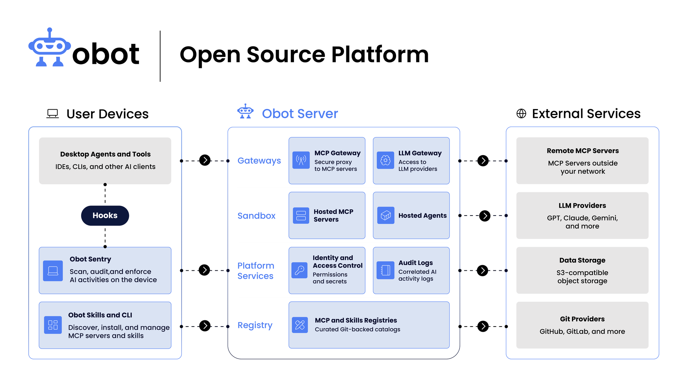

# Obot

Obot is an open-source platform for organizations to manage, secure, and govern their AI ecosystems. It provides shared infrastructure for connecting AI clients to models and tools, distributing approved MCP servers and skills, managing agent access and credentials, running hosted AI workloads, and recording activity across hosted services and user devices.

Obot does not require an organization to standardize on a single AI client, model provider, or tool ecosystem. Desktop agents and tools such as Claude Code, Codex, Cursor, VS Code, and other IDEs and CLIs can use the parts of the platform that apply to them.

## Architecture



The Obot Platform connects AI activity on user devices with services managed by or proxied through Obot Server.

On user devices, desktop agents and tools connect to Obot gateways, while Obot Sentry scans, audits, and enforces policy on AI activity taking place on the device. The Obot CLI lets users and AI clients discover, install, and manage approved MCP servers and skills.

Obot Server provides:

- MCP and LLM gateways for controlled access to MCP servers and model providers.
- Isolated execution for hosted MCP servers and Claude Environments sessions.
- Platform services for identity and access control, including permissions and secrets.
- Correlated audit logs of AI activity across the platform.
- MCP and Skills registries built on curated Git-backed catalogs.

Obot integrates with remote MCP servers, LLM providers, S3-compatible object storage, Git providers, and auth providers.

## Core Capabilities

### MCP Gateway

The MCP Gateway is a single governed entry point to every MCP server a user is allowed to reach.

- Expose MCP servers through virtual MCP servers (vMCPs), which combine one or more catalog servers behind a single endpoint, whether those servers are hosted by Obot or run outside it.
- Reach remote MCP servers on private networks through MCP tunnels, which connect outbound to Obot so no inbound port has to be opened.
- Pin each vMCP component to a snapshot of its catalog entry, so catalog changes take effect only through an explicit upgrade.
- Control server and tool access by user or identity-provider group through vMCP profiles.
- Enable tool search on large vMCPs so clients search for and call tools without loading every tool definition into the model's context.
- Chat with and call tools on any vMCP you can access using the built-in MCP tester.
- Manage MCP OAuth, user and shared credentials, and Kubernetes secret bindings.
- Inspect, reject, or modify MCP requests and responses with MCP, webhook, or built-in credential filters.

### LLM Gateway

The LLM Gateway presents provider-compatible endpoints that AI clients use to reach approved models.

- Connect external AI clients to OpenAI, Anthropic, Amazon Bedrock, Azure, and Generic Responses Compatible providers.
- Keep provider credentials in Obot instead of distributing them to individual users or clients.
- Authenticate clients with scoped Obot API keys.
- Restrict the models visible and callable by each user through Model Access Policies.
- Record requests and responses, client and session metadata, token usage, and estimated model cost.

### Hosted MCP Servers

Obot can run MCP servers itself, in isolated execution environments outside the main Obot Server process.

- Host `npx`, `uvx`, and containerized MCP servers as Docker containers or Kubernetes workloads.
- Turn any HTTP API with an OpenAPI schema into a hosted MCP server, with one tool per API operation.
- Apply domain-based egress rules to hosted MCP servers through a configured network-policy provider.

### Claude Environments

Claude Environments runs Claude cloud sessions on an organization's own Kubernetes infrastructure. Users keep working in Claude, while Obot controls who can start a session and what that session can reach. Claude Environments is experimental and disabled by default. Support for more agent platforms is planned.

- Grant access through profiles that map users and groups to vMCPs, CPU and memory limits, and egress rules.
- Limit session traffic to allowed hosts and inject destination-specific secrets at the egress gateway, so sessions never see them.
- Scope vMCP credentials to the Obot user mapped to each Claude organization member.
- Record every egress request in the audit logs.
- Run isolated sessions and suspend idle workspaces with [Agent Substrate](https://github.com/agent-substrate/substrate).

### MCP and Skills Registries

The MCP and Skills Registries centralize the discovery, installation, and management of MCP servers and Agent Skills.

- Curate MCP and Skills catalogs in Obot or index them from Git-backed repositories.
- Manage vMCP definitions and OpenAPI-backed servers in Git-backed catalogs alongside other catalog entries.
- Keep deployed servers running when their entry is removed from a Git-backed catalog.
- Expose MCP catalogs through the standard MCP Registry API.
- Publish approved MCP servers and skills to users and AI clients.
- Control access to individual entries, repositories, or complete catalogs with MCP and skill access policies.
- Reuse centrally managed Git credentials across MCP and Skills catalog sources.
- Integrate with GitHub, GitLab, Bitbucket Cloud, and other Git providers.

### Obot CLI and Skill

The Obot CLI brings approved MCP servers and skills to users and their local AI clients, and the Obot skill teaches an agent to use the CLI itself.

- Search for and install approved skills.
- Search for approved MCP servers.
- Run and manage skills from the command line.
- Install the Obot skill so an agent can work with Obot on its own.

### Obot Sentry

[Obot Sentry](https://github.com/obot-platform/obot-sentry) extends Obot governance to AI activity occurring directly on user devices. Device Management is currently beta.

- Enroll devices with the Obot Platform.
- Inventory installed AI clients, MCP servers, skills, and plugins.
- Install hooks for Claude Code, Codex, Cursor, Kiro, and VS Code.
- Record local tool calls alongside activity passing through Obot gateways.
- Enforce tool-call allowlists for Claude Code, Codex, Cursor, and Kiro on managed devices (experimental).
- Install manually or deploy through MDMs such as Microsoft Intune.

### Identity and Access Control

Obot governs who can reach each part of the platform, and with which credentials.

- Authenticate users through configured identity providers.
- Provision users, groups, and group memberships from Okta through SCIM, and deactivate users when they are unassigned.
- Assign platform roles and permissions.
- Control access to MCP servers, MCP tools, skills, models, and administrative APIs.
- Apply policies based on individual users or identity-provider groups.
- Issue scoped credentials for AI clients and automation.
- Restrict sensitive audit content to users with the appropriate role.

### Audit Logs and Visibility

Obot correlates activity across MCP servers, LLM providers, hosted workloads, and user devices.

- Record MCP requests and responses.
- Record LLM Gateway requests, responses, token usage, and model cost.
- Record local AI-client tool calls captured by Obot Sentry.
- Record egress requests from Claude Environments sessions.
- Filter activity by user, server, tool, provider, model, client, device, session, or API key.
- Track MCP and LLM usage and token spend across users and resources.
- Export audit data once or on a schedule.

## Getting Started

For local development or evaluation, run Obot with Docker:

```bash
docker run -d \
  --name obot \
  -p 8080:8080 \
  -v obot-data:/data \
  -v /var/run/docker.sock:/var/run/docker.sock \
  -e OBOT_SERVER_ENABLE_AUTHENTICATION=true \
  -e OBOT_BOOTSTRAP_TOKEN=<token> \
  ghcr.io/obot-platform/obot:latest
```

The bootstrap token must be at least six characters. If you omit `OBOT_BOOTSTRAP_TOKEN`, Obot generates one and prints it in the container logs.

Open [http://localhost:8080](http://localhost:8080), sign in with the bootstrap token, and configure an authentication provider. For evaluation, the built-in Local provider lets you create user accounts without setting up an external identity provider. A model provider is required only when using the LLM Gateway. The UI is available in English, Japanese, Korean, and Simplified Chinese.

This Docker configuration mounts the host Docker socket so Obot can launch hosted MCP servers as sibling containers. Use it only for development, evaluation, or trusted single-tenant environments. Use the Kubernetes deployment for production or multi-tenant installations.

See the [Installation Guide](https://docs.obot.ai/installation/overview) for Kubernetes, external PostgreSQL, encryption, authentication, and production configuration.

## Design and architecture

Significant changes begin as [Obot Design Proposals](https://github.com/obot-platform/obot-design-proposals) so the architecture can be discussed before implementation. Architectural decisions that ship are recorded as concise [Architecture Decision Records](adr/README.md) in this repository.

An ODP captures the proposed design and the discussion that shaped it. An ADR records the durable decision reflected in the implementation.

## Documentation and Community

- Documentation: [https://docs.obot.ai](https://docs.obot.ai)
- Discord: [https://discord.com/invite/9sSf4UyAMC](https://discord.com/invite/9sSf4UyAMC)

## License

Obot is licensed under the [MIT License](LICENSE). Every edition, including Obot Community and Obot Enterprise, runs the same open source code from the same container image, and editions differ only in their license key. See [Editions and licensing](https://docs.obot.ai/enterprise/overview) for user and device limits and what each edition includes.
