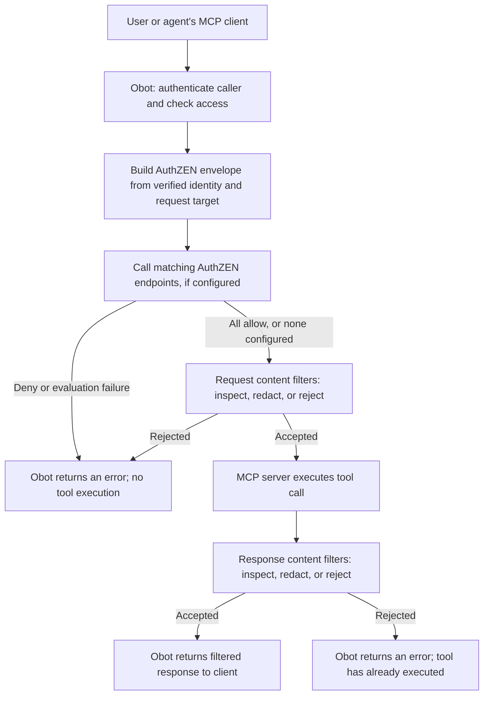

Filters inspect MCP requests and responses. Configure a filter to accept, reject, or modify matching traffic; use [private-network tunnels](./mcp-tunnels.md) when the problem is reaching a remote server.

Custom HTTP webhook filters can also use [AuthZEN authorization](#authzen-authorization) to decide whether an authenticated caller may make a request. See the [request pipeline](#request-pipeline) for how authorization and content filtering fit together.

## Overview {#overview}


Filters inspect MCP messages and apply validation, logging, or other checks to tool calls and results.

Filters can be implemented in three ways:

- **Guardrail filters**: Checks that Obot runs itself, with [guardrails](./guardrails.md) such as secrets detection, PII detection, an LLM judge or an external content safety service. They block or redact what the guardrails find. No server, container or deployment is involved.
- **MCP filter servers**: Hosted or remote MCP servers that expose a filter tool. Hosted filters run as separate Docker containers or Kubernetes workloads. Remote filters run at an external MCP endpoint. Obot calls the configured tool when matching MCP traffic is processed. Obot's [built-in filters](#built-in-filters) are MCP filter servers.
- **HTTP webhook filters**: HTTP endpoints that receive MCP messages and return a decision to allow or reject them.

When you configure a filter, you can narrow when it runs using selectors that target particular tool calls or MCP (Model Context Protocol) tool functions.

Guardrail filters run inside the Obot process. Other filter implementations run outside it: Obot handles proxying, calls the filter, and enforces its response. In both cases the target MCP server does not host or enforce the filter. See the [request flows and trust boundaries](../architecture/request-flows.md).


## How Filters Work {#how-filters-work}


1. **MCP Request Interception**: When a request is made to an MCP server, the gateway intercepts it and sends the details to your configured filter
2. **Payload Inspection**: The filter server or webhook receives the payload and performs its validation. A guardrail filter is checked by Obot itself.
3. **Response Decision**: Your filter returns one of the following decisions:
   - Accept: Allow the tool call to proceed
   - Reject: Block execution and return an error to the user
   - Mutate: Return a modified MCP message, if mutation is allowed for the filter
4. **Enforcement**: Obot applies the filter response before forwarding the request or returning the response to the client.

When several filters apply to a server, they run as a chain, ordered by the filter's ID. Each filter sees the message as the filters before it left it, so a mutation by one filter is what the next one checks. A rejection by any filter blocks the message. Responses pass through the chain in the same order.

Filters don't apply to Obot's own system MCP servers, such as filter servers themselves, or to the component servers of a composite server, whose traffic is filtered on the composite server.

Each filter that runs on a message is recorded with the message in the MCP audit log, under the filter's name, with its outcome (`ok`, `mutated` or `rejected`) and reason. For a filter server, the audit log also names the filter tool that was called. For a guardrail filter, it says `guardrail`.


## Request pipeline {#request-pipeline}

For a client tool call, Obot runs matching authorization callbacks before the
content filter chain. Obot enforces each decision; the policy service supplies
the authorization decision.



- **Identity and target:** Obot supplies the authenticated user ID, deployed
  server ID, method, and operation selectors. An agent acting through a user's
  credentials is identified as that user; this version does not establish a
  separate agent identity or on-behalf-of delegation. For vMCP tool search, Obot
  resolves the underlying tool before authorization.
- **Authorization payload:** The policy callback receives identity and target
  metadata, not tool arguments or response content. For example, an SSN in tool
  arguments is not sent to the authorization endpoint before redaction. Existing
  content-filter payloads do not gain an identity block.
- **Content filtering:** Matching content filters receive the MCP payload and
  can redact argument values before execution. They cannot change the authorized
  method or operation selectors. Response filtering happens after execution, so
  rejecting a response does not undo a tool's side effects.
- **Optional enforcement:** There is no default authorization policy. Without
  an enabled matching callback, requests follow the existing content-filter path.
  An authorization denial returns HTTP 403, a rate-limit denial returns 429,
  and an evaluation failure returns 503. Decisions appear in MCP audit logs.

The same authorization stage applies to other matching client JSON-RPC requests,
including prompts and resources. Notifications, server-originated messages, and
responses are not evaluated by AuthZEN. See [Optional AuthZEN authorization](#authzen-authorization)
for configuration, payloads, signatures, and decision examples.

## Gateway Configuration {#gateway-configuration}


Open **MCP Servers > Filters** and use **Add New Filter** to configure a guardrail filter, a custom filter (an HTTP webhook or an MCP filter server), or a built-in filter. Choose selectors for the traffic it should process, then test both an accepted and a rejected request. The list of filters shows each filter's type. See the [filter contracts and examples](../reference/filter-schemas.md) when implementing the filter service.


### Selectors {#selectors}


All filter types support selectors to control when your filter is triggered:

- **Specific MCP Tool Call Methods**: Target particular tools or functions
- **MCP Tool Names, URIS**: Choose which MCP servers the filter applies to


## Guardrail Filters {#guardrail-filters}


A guardrail filter checks MCP traffic with [guardrails](./guardrails.md#guardrail-types), the same guardrails that check LLM gateway traffic. Obot runs it in-process, in the filter chain with any other filters, so there is no filter server to deploy, configure, launch or restart, and no server details, logs or usage to show. Its detail page shows only its configuration. Its result on each message is recorded on the [MCP audit log](../security/audit-data.md) entries of the servers it filters.

To create one, select **Add New Filter > Create From Guardrail** under **MCP Servers > Filters**, then configure:

- **Name**: A descriptive name. It names the filter in block messages and the MCP audit log.
- **MCP servers and selectors**: Which servers and which methods, tools, prompts or resources the filter applies to, as for any filter.
- **Guardrails**: One or more guardrails. Create or test them on the **Guardrails** tab of **LLM Gateway**, or create one from the picker.
- **Action**:
  - **Block** rejects the message with an error naming the filter and what was found. You can replace that message with your own.
  - **Redact** replaces what was found with a label such as `[REDACTED:EMAIL]` and lets the rest through. Some guardrails can only tell that content is a problem, not where it is. A redacting filter blocks when one of those finds something.
- **Direction**: Whether to check requests to the MCP server, its responses, or both.
- **Fail closed**: Whether to block when a guardrail or the condition can't be evaluated, for example because an external service is down or one of its guardrails is missing. By default, the message passes, and the MCP audit log records which guardrail failed and why. If Obot can't load guardrails at all, for example because its database is unreachable, guardrail filters block regardless of this setting, as any filter that errors does.
- **Sampling rate**: The percentage of matching messages to check, for expensive guardrails.
- **Users & Groups**: The users and groups the filter applies to, or **All Obot Users** for everyone. A filter with none applies to everyone.
- **Condition** (optional): A [CEL](https://github.com/google/cel-spec) expression that must be true for the filter to apply. It can use `mcp_method`, `mcp_tool` (the tool or prompt name, or the resource URI), `mcp_arguments` (the tool call's or prompt's arguments), `mcp_server` (the server's display name), `headers` (the request's headers, without credentials), and `user.id` and `user.groups`. `user.groups` holds the IDs of the user's auth provider groups, the same IDs that group subjects use, not group names or Obot roles. For example: `mcp_tool.startsWith("create_") && !("<contractors group ID>" in user.groups)`. Reading a header or argument that isn't there is an error, so test for it first: `"path" in mcp_arguments`.

### What a guardrail filter checks {#what-a-guardrail-filter-checks}

| Method | Request | Response |
| --- | --- | --- |
| `tools/call` | Every string in the tool's arguments | The result's text content, embedded text resources and structured content |
| `resources/read` | Nothing | The text contents of the resource |
| `prompts/get` | Every string in the prompt's arguments | The text of the prompt's messages, including embedded text resources |

Images and other binary content are not checked. Other methods carry no content to check and pass through a guardrail filter unchanged.

A blocked request never reaches the MCP server, and a blocked response is replaced by a JSON-RPC error. Responses are checked whichever stream they arrive on, including a GET stream when a client resumes a stream or uses the legacy SSE transport. While any filter applies to a server, JSON-RPC batches sent to it are refused, since filters check one message at a time. A guardrail filter blocks a request whose parameters it can't read.

Guardrail filters can block or redact, but not log only. The MCP audit log entry of each checked message has a status for the filter, under its name: `rejected` with the block message, `mutated` for a redaction, or `ok`. When a guardrail fails and the filter fails open, the `ok` status's message names the guardrail and the error. The MCP audit log records both the original and the redacted message.

A guardrail filter is shown as not configured while one of its guardrails is missing or can't be used, for example because it lacks a required credential. It still runs, and fails as described under **Fail closed**.


## MCP Filter Servers {#mcp-filter-servers}


MCP filters can be deployed as MCP servers. Their deployment configuration is similar to other MCP servers in Obot: choose a runtime such as `remote`, `containerized`, `npx`, or `uvx`, then provide the runtime-specific configuration and any required environment variables.

With `remote`, Obot connects to the configured endpoint and does not deploy the filter implementation. The other runtimes deploy a separate workload; a hosted filter does not run inside Obot or inside the target MCP server.

The additional requirement for an MCP filter server is a filter tool name. Obot needs this value so it knows which tool to call when the filter runs.

### Filter Tool Contract {#filter-tool-contract}


When you write an MCP server that acts as a filter, implement the tool called by `filterConfig.toolName` with this contract:

1. Obot calls one tool on the MCP server for filtering.
2. The tool accepts the full MCP message as an argument.
3. The tool returns a response with these fields:

| Field | Description |
|-------|-------------|
| `accept` | Whether the MCP message should be allowed to continue. |
| `mutated` | Whether the filter returned a modified MCP message. Use this only when the filter is allowed to mutate traffic. |
| `message` | The MCP message to use after filtering. For non-mutating filters, return the original message. |
| `reason` | Human-readable explanation for the decision. Include this when rejecting or mutating a message so administrators can understand the result. |

See the [obot-platform/pii-filter](https://github.com/obot-platform/pii-filter) repository for an example MCP filter server.

## Built-in Filters {#built-in-filters}


Obot ships with a default set of built-in filters. These are MCP filter servers that are already configured for deployment in Obot through the system MCP catalog.

The default built-in filter catalog is maintained in the [obot-platform/system-mcp-catalog](https://github.com/obot-platform/system-mcp-catalog) repository.

A built-in filter can require a minimum or maximum Obot version. Filters that the running Obot version does not support are not listed. If a built-in filter you expect is missing, check whether it requires a newer Obot version. See [Obot version range](../configuration/mcp-server-gitops.md#obot-version-range).

## HTTP-based Filters {#http-based-filters}


Deploy a webhook service that accepts MCP messages over HTTP. Configure its URL in Obot, which sends matching messages to the webhook and uses its response to allow or reject them.

Provide the following information to Obot:

### Required Configuration {#required-configuration}


- **Name**: A descriptive name for your filter
- **URL**: The webhook endpoint that receives MCP messages
- **Secret** (optional): A shared secret with the webhook receiver for payload signature verification

### Security with Secrets {#security-with-secrets}


Configure the same shared secret in Obot and your webhook service. When a secret is configured, webhook requests include a signature in the `X-Obot-Signature-256` header. Your service should verify this signature before processing the request.

### Webhook Receiver {#webhook-receiver}


Your webhook endpoint must accept HTTP POST requests containing MCP messages.

### Payload Structure {#payload-structure}


The webhook will receive a payload with this data structure:

```python
# Pydantic Model
class WebhookMessage(BaseModel):
    """JSON-RPC message structure for webhook payloads."""
    jsonrpc: str
    id: Optional[Union[str, int]] = None
    method: Optional[str] = None
    params: Optional[Dict[str, Any]] = None
    result: Optional[Dict[str, Any]] = None
    error: Optional[Dict[str, Any]] = None
```

- **Signature Header**: Used for verifying the payload authenticity (when secrets are configured)

`X-Obot-Signature-256`

### Response Codes {#response-codes}


Your webhook service should respond with:

- **HTTP 200**: Accept the tool call - allows execution to proceed
- **Non-200 codes**: Reject the tool call - blocks execution and may return an error to the user

### Example {#example}


This Python example inspects the search tools query param in the DuckDuckGo MCP Server.

To run this example, execute the following once you have saved the script in `simple_webhook_example.py`:

```bash
uv add fastapi uvicorn pydantic
PORT=8000 WEBHOOK_SECRET=somethingsecret uv run simple_webhook_example.py
```

The filter target url will be `http://<host>:8000/webhook`

Set the Webhook Secret in Obot to the same value as `WEBHOOK_SECRET` in this example.

```python
#!/usr/bin/env python3
"""
Simple webhook endpoint with signature validation

Usage:
    uv run simple_webhook_example.py

Environment Variables:
    WEBHOOK_SECRET: Secret for webhook signature validation (default: "test_secret")
    PORT: Port to run the server on (default: 8000)
"""

import hmac
import hashlib
import os
import logging
from typing import Dict, Any, List, Optional, Union
from fastapi import FastAPI, Request, HTTPException, Header
from pydantic import BaseModel

# Configure logging
logging.basicConfig(
    level=logging.INFO,
    format='%(asctime)s - %(levelname)s - %(message)s'
)
logger = logging.getLogger(__name__)

def validate_signature(body: bytes, signature: str, secret: str) -> bool:
    """
    Validate HMAC-SHA256 signature for webhook security.
    
    Args:
        body: Raw request payload
        signature: Signature from X-Obot-Signature-256 header
        secret: Shared secret for validation
    
    Returns:
        True if signature is valid, False otherwise
    """
    # Remove "sha256=" prefix if present
    if signature.startswith("sha256="):
        signature = signature[7:]
    
    # Calculate expected signature
    expected = hmac.new(
        secret.encode('utf-8'), 
        body, 
        hashlib.sha256
    ).hexdigest()
    
    # Secure comparison
    return hmac.compare_digest(signature, expected)

class WebhookMessage(BaseModel):
    """JSON-RPC message structure for webhook payloads."""
    jsonrpc: str
    id: Optional[Union[str, int]] = None
    method: Optional[str] = None
    params: Optional[Dict[str, Any]] = None
    result: Optional[Dict[str, Any]] = None
    error: Optional[Dict[str, Any]] = None

# Initialize app
app = FastAPI(title="Simple Webhook with Filtering")

# Configuration
SECRET = os.getenv("WEBHOOK_SECRET", "test_secret")
PORT = int(os.getenv("PORT", "8000"))

@app.post("/webhook")
async def webhook_endpoint(
    request: Request,
    x_obot_signature_256: str = Header(alias="X-Obot-Signature-256")
):
    """
    Main webhook endpoint that validates signatures and processes messages.
    """
    body = await request.body()
    
    # Log the incoming request
    logger.info(f"📥 Webhook called - Method: {request.method}, URL: {request.url}")
    logger.info(f"📄 Request body: {body.decode('utf-8', errors='replace')}")
    logger.info(f"🔐 Signature header: {x_obot_signature_256}")
    
    # Validate signature
    if not validate_signature(body, x_obot_signature_256, SECRET):
        logger.error("❌ Invalid webhook signature")
        raise HTTPException(status_code=401, detail="Invalid signature")
    
    try:
        # Parse message
        message = WebhookMessage.model_validate_json(body)
        logger.info(f"✅ Processing {message.method} message")
        
        # Check all requests for suspicious content
        check_message_for_threats(message)
        
        logger.info(f"🎉 Webhook processed successfully: {message.method}")
        return {"status": "accepted", "message": "Webhook processed successfully"}
        
    except HTTPException:
        # Re-raise HTTP exceptions (like 403 from threat detection)
        raise
    except Exception as e:
        logger.error(f"Error processing webhook: {e}")
        raise HTTPException(status_code=400, detail=f"Invalid payload: {str(e)}")

def check_message_for_threats(message: WebhookMessage) -> None:
    """
    Check DuckDuckGo search requests for unsafe query content.
    
    This example specifically looks for DuckDuckGo search tool usage
    and filters based on the search query content.
    
    Args:
        message: JSON-RPC message to check
        
    Raises:
        HTTPException: 403 status if unsafe search query detected
    """
    logger.info(f"Checking message for threats: {message.method}")
    
    # Look for DuckDuckGo search tool calls
    if message.method == "tools/call" and message.params:
        tool_name = message.params.get("name")
        arguments = message.params.get("arguments", {})
        
        if tool_name == "search" and "query" in arguments:
            query = arguments["query"]
            logger.info(f"🔍 Checking DuckDuckGo search query: '{query}'")
            
            if is_unsafe_search_query(query):
                logger.error(f"🚫 UNSAFE SEARCH QUERY BLOCKED: '{query}'")
                raise HTTPException(
                    status_code=403, 
                    detail="Search query rejected due to content policy"
                )
            else:
                logger.info(f"✅ Safe search query: '{query}'")
    
    logger.debug(f"✅ Clean message: {message.method}")

def is_unsafe_search_query(query: str) -> bool:
    """
    Check if a DuckDuckGo search query contains unsafe content.
    
    Args:
        query: The search query string
        
    Returns:
        True if query should be blocked, False if safe
    """
    if not query or not isinstance(query, str):
        return False
    
    query_lower = query.lower()
    
    # Simple list of terms we don't want to allow in searches
    unsafe_terms = [
        "how to hack",
        "how to exploit", 
        "malware download",
        "virus download",
        "illegal drugs",
        "how to make bomb",
        "assassination",
        "terrorist",
    ]
    
    for term in unsafe_terms:
        if term in query_lower:
            logger.warning(f"Found unsafe search term: '{term}'")
            return True
    
    # Block excessively long queries (potential injection attempts)
    if len(query) > 200:
        logger.warning(f"Query too long: {len(query)} chars")
        return True
    
    return False

@app.get("/health")
async def health_check():
    """Simple health check endpoint."""
    return {"status": "healthy", "filter": "ready"}

@app.get("/")
async def root():
    """Root endpoint with basic information."""
    return {
        "message": "Simple Webhook with Tool Filtering",
        "endpoints": {
            "/webhook": "Main webhook endpoint (POST)",
            "/health": "Health check (GET)",
            "/": "This information (GET)"
        },
        "note": "Send JSON-RPC messages to /webhook with proper signatures. Suspicious content will result in 403 responses."
    }

def main():
    """Start the webhook server."""
    import uvicorn
    
    logger.info("🚀 Starting Simple Webhook Server with Content Filtering")
    logger.info(f"🌐 Host: 0.0.0.0")
    logger.info(f"🔌 Port: {PORT}")
    logger.info(f"🔐 Secret configured: {'Yes' if SECRET != 'test_secret' else 'Using default (change WEBHOOK_SECRET)'}")
    logger.info(f"📋 Available endpoints:")
    logger.info(f"   POST /webhook - Main webhook endpoint")
    logger.info(f"   GET /health - Health check")
    logger.info(f"   GET / - Server information")
    
    uvicorn.run(
        app,
        host="0.0.0.0",
        port=PORT,
        log_level="info"
    )

if __name__ == "__main__":
    main()
```

## Credential filter

The built-in Credential Filter uses a default action (Block, Redact, or Allow)
and optional exceptions for exact credential rules. Block is the default. Search
by provider, credential name, or rule ID to add an override. Changing the default
preserves explicit overrides; removing an override restores inheritance.

Any blocking match rejects the entire message. Allow affects only its rule;
another matching rule can still block the same credential. Redaction enables
gateway mutation automatically and replaces detected text with
`[REDACTED_CREDENTIAL]`. It may also replace surrounding context or an entire
field value. Redact findings in object keys or JSON-RPC identifiers block instead.

Select both request and response directions where both need protection. Configure
the gateway's existing failure setting to reject on filter transport or execution
failures. Saving configuration does not establish protection until the managed
filter deployment successfully initializes.

Detection is pattern-based, without live credential validation or confidence
thresholds. It can produce false positives and does not recognize every secret.
Allow passes credentials unchanged; it does not create findings history. Policy
is deployment configuration and cannot be overridden by tool arguments.

## Optional AuthZEN authorization {#authzen-authorization}

A custom **Webhook URL** filter can also authorize requests before content
filtering. In its existing editor, enable **Authorize requests with AuthZEN**,
enter the policy service's HTTPS evaluation URL and, optionally, a separate signing secret,
then save. The content webhook URL remains required. Both callbacks use the
filter's existing MCP server attachments and method/identifier selectors.

For example, select the CRM server, method `tools/call`, and identifier
`get_customer`. The policy service receives the authenticated principal,
CRM server ID, and tool name. It can keep a counter keyed by those values to
implement a per-user limit. Obot does not install a default policy or maintain
rate-limit counters.

Obot evaluates all matching authorization callbacks before any content request
callbacks. Only an HTTP 200 response containing `{"decision":true}` permits the
request to continue. An explicit `{"decision":false}` produces HTTP 403 (or HTTP 429 for the rate-limit extension below);
timeouts, missing credentials, invalid responses, and other policy-service
failures produce HTTP 503. The JSON-RPC error retains the request ID without
exposing the policy service's response body. Evaluation is limited to five
seconds per callback and fifteen seconds for the authorization stage, with no
automatic retries, redirect following, or decision caching. Network access uses
the gateway's existing remote-MCP address restrictions.

Authorization covers client JSON-RPC requests, including tools, resources,
prompts, discovery and initialization, according to the configured selectors.
It does not evaluate notifications, server-originated messages, or responses.
Content response filtering stays unchanged. When the target has an enabled authorization callback, content filters may
change argument values but cannot change the method or mapped operation selectors
(tool/prompt name, resource URI, or completion reference and argument name),
including changing an unmatched request into one covered by an authorization selector.

### One filter, two endpoints

A single filter can use `/authorize` and `/filter` on the same deployed service.
Both endpoints share Obot's existing attachments and selectors, so the customer
can package authorization and content inspection into one deployment. They may
also point to different services. Each endpoint has its own signing secret;
Obot does not copy the content secret into authorization configuration.

### Authenticating authorization requests

Authorization callbacks use the same HMAC-SHA256 convention as content webhooks.
Optionally configure an **Authorization signing secret** in Obot and the same value in the
authorization receiver. When a secret is configured, Obot sends:

```text
X-Obot-Signature-256: sha256=<lowercase hex HMAC-SHA256 of the raw request body>
```

Without a configured secret, Obot sends the request over HTTPS without a signature
header. The policy service decides whether to accept unsigned requests; it may
rely on deployment-level access controls. An explicit authorization decision is
still required. Obot records whether signing has been configured separately from
the credential, so a missing or unreadable configured secret blocks the request
with HTTP 503 rather than silently sending it unsigned. Leaving a saved secret
blank on an edit preserves signing.

The key is the UTF-8 bytes of the configured secret. The receiver must verify
the signature against the exact received body bytes using a constant-time
comparison, before parsing or evaluating the request. The existing
[signature verification example](#http-based-filters) works for this envelope
too. The shared secret itself is not sent. No bearer authentication is provided
for authorization callbacks in this slice. HTTPS remains required.

When configured, the signature authenticates Obot and protects the body; it does
not authenticate the end user independently. Obot supplies authenticated user or
agent identity in the AuthZEN envelope. This body-only signing convention does not establish request freshness
or prevent replay by itself. Stateful receivers should account for duplicate
`context.obot.evaluation_id` values; timestamp-based freshness is not part of
this contract. Existing content signature semantics remain unchanged.

### Evaluation payload

Obot POSTs the following envelope to the exact configured endpoint:

```json
{
  "subject": {
    "type": "user",
    "id": "42"
  },
  "action": {
    "name": "tools/call",
    "properties": {"tool": "get_customer"}
  },
  "resource": {
    "type": "mcp-server",
    "id": "ms1bxcmj"
  },
  "context": {
    "obot": {
      "version": 1,
      "mapping": "obot-mcp-requests-v2",
      "authority": "https://obot.example.com",
      "evaluation_id": "24d04ccf-7825-4a26-ae7b-169b309b1643",
      "catalog_id": "default",
      "catalog_entry_id": "<CRM-catalog-entry-id>"
    }
  }
}
```

`action.name` is always the exact MCP method; `resource.type` is always
`mcp-server`. For ordinary MCP servers, `resource.id` is the deployed `MCPServer`
ID, not its catalog entry or per-user `MCPServerInstanceID`. For vMCPs, the current
experimental mapping instead uses the selected `VMCPInstance` connection ID
(`vmcpi...`); see the vMCP distinction below.

| MCP method | `action.properties` |
| --- | --- |
| `tools/call` | `{"tool":"echo"}` |
| `prompts/get` | `{"prompt":"summarize"}` |
| `resources/read`, `resources/subscribe`, `resources/unsubscribe` | `{"uri":"crm://customers/123"}` |
| `completion/complete` for a prompt | `{"ref":{"type":"ref/prompt","name":"summarize"},"argument":"style"}` |
| `completion/complete` for a resource template | `{"ref":{"type":"ref/resource","uri":"crm://customers/{id}"},"argument":"id"}` |
| Discovery (`tools/list`, `prompts/list`, `resources/list`, `resources/templates/list`), `initialize`, `ping`, other methods | Omitted |

Only named selectors are extracted. Tool/prompt arguments, completion argument
values and context, cursors, and arbitrary metadata are not disclosed. Missing
or invalid required operation selectors fail closed with HTTP 503 before the
policy callback. Unrelated parameters do not suppress valid selectors. Other
MCP validation remains the responsibility of the downstream handler. Discovery authorization permits or rejects the whole request, not
individual entries; allowing discovery does not imply invocation permission.

`context.obot.catalog_id` and `catalog_entry_id` come from Obot's resolved server
configuration, are omitted when absent, and are not caller assertions. Policies
can match a catalog entry across deployments or match `resource.id` for one
specific deployment. The catalog entry ID is scoped by the Obot authority.

For a vMCP target, the envelope contains its selected connection ID and exposed
tool name. Filter attachments and the central audit log's `mcpID` use the parent
`vmcp...` ID, so those IDs are not interchangeable with `resource.id`. The current
vMCP server configuration supplies no catalog association, and the envelope does
not include the parent vMCP ID. A policy keyed to a parent vMCP cannot directly
match that ID in this experimental payload. Parent/instance identity enrichment
remains a design follow-up. No component identity or component catalog association
is inferred before routing.

The mapping is `obot-mcp-requests-v2`. The envelope vocabulary remains `version: 1`;
this mapping revision replaces the experimental v1 tool-as-action shape and
removes duplicated `context.obot.request.method/identifier`. Receivers using the
experimental mapping must update with the gateway. Existing content filters and
the optional rate-limit decision response are unchanged.

Subject IDs come from Obot authentication with type `user`. Hosted-agent authentication was removed upstream; agent identities and verified on-behalf-of assertions remain future work. Arguments, groups, source IP, User-Agent and caller-provided delegation
claims are not included in this first version. COAZ and client changes are not
required.

The authorization signing secret is stored with encrypted filter credentials, bound to
its endpoint, and excluded from content-runtime configuration and reveal
responses. Leave the signing secret blank when editing to keep it; changing a signed endpoint
requires re-entering the signing secret. Removing the content signing secret preserves the
authorization credential.

Evaluations appear under the protected request's existing **Audit Logs**
webhook statuses with type `authorization`, stable `filterID`, `allow`,
`deny` or `error`, evaluation ID, mapping version and duration. An allow
decision records admission, not successful upstream execution. External rate
limits therefore count admission attempts, including requests later rejected
by content filters or failed upstream.

Existing filters are unchanged until authorization is enabled. API updates
that omit `authorization` preserve it; use `{"authorization":{"enabled":false}}`
to explicitly disable it. This version does not support an authorization tool
on MCP-backed filters, authorization-only filters, configurable payload
disclosure, or a new filter-scoped audit query. Disable authorization explicitly
before downgrading to an Obot version that does not understand it.

### Rate-limit decisions

A receiver may identify a quota denial using this optional Obot-owned response
extension in AuthZEN's context. This is not a standard AuthZEN or MCP field:

```json
{
  "decision": false,
  "context": {
    "obot": {
      "reason": "rate_limited",
      "retry_after_seconds": 30
    }
  }
}
```

Obot responds to the MCP client with HTTP **429**, `Cache-Control: no-store`, and
`Retry-After: 30`. The JSON-RPC response preserves the request ID and existing
error code `-32001`, with a clean message and machine-readable data:

```json
{
  "jsonrpc": "2.0",
  "id": 2,
  "error": {
    "code": -32001,
    "message": "Rate limit exceeded. Try again in 30 seconds.",
    "data": {"reason": "rate_limited", "retry_after_seconds": 30}
  }
}
```

`retry_after_seconds` is optional; when present it must be an integer from 1 to
86400. Invalid values on a rate-limit denial fail closed with HTTP 503. When it
is absent, Obot omits `Retry-After` and says “Rate limit exceeded. Try again later.”
The receiver still returns HTTP **200** to Obot with its decision; a callback
HTTP 429 is a receiver failure, not a policy decision.

Boolean-only denials and unrecognized reasons remain HTTP 403. Obot generates
client messages from the recognized reason; it does not forward arbitrary policy
messages or response context. Authorization errors omit the generic internal hook
error prefix. Content-filter error behavior is unchanged. Quota accounting stays
in the receiver, and no automatic retries are introduced. The existing audit
record carries the actual response status/body and the authorization `deny` event.

MCP audit outcomes classify HTTP 429 as **denied**, alongside 401 and 403,
including 429 responses from upstream servers. The Denied and Failure audit
filters use the same classification. Existing recorded 429 rows are classified
on read; no data migration is needed. HTTP status, response body, and any
authorization-filter details remain available to distinguish the source.
