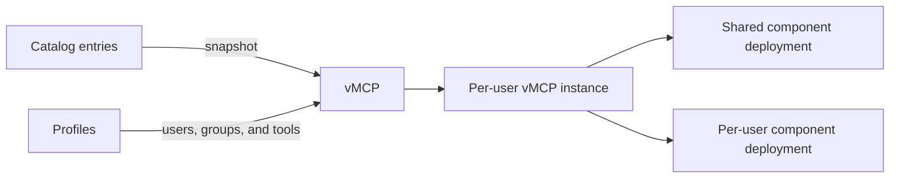

Build a vMCP from the MCP servers already available in your catalog. Select one or more servers, choose the tools to expose, and connect your AI client through one URL. Administrators can share vMCPs with users and groups; other users can create personal vMCPs for themselves.

For a first walkthrough, follow [Create a vMCP](../start-here/govern.md).

## Prerequisites {#define-the-catalog-entry}

Choose servers available in **MCP Servers** and have any required service credentials ready. A personal vMCP's owner must have access to the entries they use. If a server is missing, an administrator can [add a remote server](./register-remote.md) or [add a hosted server](../concepts/mcp-hosting.md) first.

## Create a shared vMCP as an administrator {#virtual-mcps-create-a-shared-vmcp-as-an-administrator}

1. Open **vMCPs** and select **Create vMCP**.
2. Drag an MCP server from the **MCP Servers** panel onto the vMCP. Repeat to add more components.
3. Enter a name and description, then select **Create**.
4. For each component, choose how every configuration field is supplied. See [Configuration policies](./server-types.md#virtual-mcps-configuration-policies). For a remote component that uses OAuth, you can also [preconfigure OAuth](#preconfigured-oauth) with one account that everyone uses.
5. Choose **Managed** in the **Add Tools** dialog to discover and select the component's exposed tools. You can disable tools, rename them, change their descriptions, or add a prefix to avoid name collisions. **As-is** instead passes through the upstream tools and definitions, including future changes, without discovery during setup.
6. Open **Profiles** and replace or refine the default access grant. Assign users, groups, or **All Obot Users**, then choose the tools that profile grants.
7. Connect to or test the vMCP after its components are ready.

:::note

A new administrator-created shared vMCP includes a default profile that grants all administrators access to every component. Administrators can replace or refine this profile to grant access to other users or groups. A personal vMCP remains accessible only to its owner.

:::

Profiles are grant-only and additive. If a user matches several profiles, Obot combines their tool grants. A narrower profile cannot deny a tool granted by another matching profile, so review broad profiles when troubleshooting unexpected access.

## Create a personal vMCP as a user {#virtual-mcps-create-a-personal-vmcp-as-a-user}

1. Open **vMCPs** and select **Create vMCP**.
2. Drag MCP servers available to you from the **MCP Servers** panel onto the vMCP.
3. Enter a name and description, then select **Create**.
4. Choose the configuration policy and exposed tools for each component.
5. Select **Connect** to configure and launch your connection.

The personal vMCP is accessible only by its owner, and the owner has no **Profiles** view. Selecting **Provided at connection** prompts the owner for that value when connecting.

If the owner later loses access to a selected MCP server, Obot removes that component and its component-specific configuration from the personal vMCP. If no components remain, Obot removes the personal vMCP and its instance. Deleting a source catalog entry is different: its existing snapshot can continue to run as described in [Snapshots and updates](./publish.md#virtual-mcps-snapshots-and-updates).

## How vMCPs work {#virtual-mcps-how-vmcps-work}

The main resources are:

- **Catalog entry**: Defines how an MCP server runs or where a remote server is located.
- **vMCP component**: A snapshot of a catalog entry, plus its configuration policy and exposed tools.
- **vMCP**: One stable connection endpoint containing one or more components.
- **Profile**: An administrator-defined grant that makes a shared vMCP and selected tools available to users or groups.
- **vMCP instance**: A user's connection state, credentials, and optional tool selection for a vMCP.

A vMCP with one component replaces a standalone MCP server connection. A vMCP with several components replaces a composite server and aggregates their tools behind the same endpoint.

## Shared and personal vMCPs {#virtual-mcps-shared-and-personal-vmcps}

The creator's role determines the scope of a new vMCP.

| | Administrator-created shared vMCP | User-created personal vMCP |
|---|---|---|
| Who can use it | Users and groups granted access by profiles | Its author only |
| Source catalog access for consumers | Not required | The owner must have access to every selected catalog entry |
| Access management | Administrators manage profiles and tool grants | Cannot be shared; profiles do not change its owner-only scope |
| Component access changes | Consumer catalog access does not remove components | Losing access to a catalog entry removes that component |
| Typical use | Publish a governed tool endpoint for a team or organization | Assemble a private endpoint from servers available to the user |

Only administrators can create a vMCP that other users can consume. Any user who can access catalog entries can use them in a personal vMCP, but non-administrators cannot publish that vMCP to other users or groups.

## Choose how values are supplied

### Configuration policies {#virtual-mcps-configuration-policies}

When adding a server to a shared vMCP, configure each field that still needs a value:

| vMCP option | Who supplies the value |
|---|---|
| **Preconfigured** | The vMCP creator sets the value once. Every connection to that server within the vMCP uses it. |
| **Provided at connection** | Each user supplies their own value when connecting to the vMCP. |
| **Ignore** | No value is supplied for an optional field. |

For example, preconfigure a shared region or service-account credential, and request a personal API token at connection time. You can use both options on different fields of the same server. Required fields must be **Preconfigured** or **Provided at connection**.

After configuring the values, select the exposed tools and use [profiles](./access.md#virtual-mcps-tools-and-profiles) to grant access. Preconfiguring a value shares it across that vMCP's connections; it does not grant everyone in Obot access to the vMCP.

Optional fields default to **Ignore** in the UI.

For a [Git-managed vMCP](../configuration/mcp-server-gitops.md#vmcp-definitions), configuration policies are defined in YAML. A `fixed` field can use a Kubernetes `secretBinding` instead of a clear-text value. This component-level binding is available only through Git catalog sources, requires the Kubernetes backend, and cannot override a static catalog field or accompany a `value`. Required fixed fields must have a value already stored for that component, a value supplied by the source, or a Secret binding before sync can create or update the vMCP.

## How configuration affects deployment

Configuration determines whether a component can share a deployment:

- A component with only fixed or ignored configuration is normally eligible to use a shared deployment.
- User-provided headers remain isolated per connection but do not require separate deployments.
- Any other user-provided value causes Obot to run a separate component deployment for each user.
- **Force single-user** always gives each user a separate deployment when that option is available.

Obot makes this decision independently for every component. One vMCP can therefore use shared and per-user component deployments at the same time.

Existing legacy single-user and multi-user connections remain available during the [vMCP transition](./publish.md#virtual-mcps-gitops-and-migration). Use vMCPs for new endpoints. Multiple components replace the former composite-server setup; `runtime: composite` is no longer supported in [catalog GitOps](../configuration/mcp-server-gitops.md).

## Preconfigure OAuth {#preconfigured-oauth}

By default, each user who connects to a vMCP authorizes its OAuth components with their own upstream account. On a shared vMCP, an administrator can instead preconfigure OAuth for a remote component: authorize it once, with one account that everyone uses.

While a component's preconfigured OAuth works:

- Every request to the component, from every user and every [agent](../security/agent-identities.md) that uses the vMCP, carries the preconfigured account's token.
- Users aren't asked to authorize the component, in their MCP client or in Obot. A token a user authorized for it earlier isn't used, but Obot keeps it.
- The vMCP's other components are unaffected. Each user still authorizes those with their own account.

:::warning

Everyone who uses the component through the vMCP acts upstream as the account you authorize. The provider's permissions and audit logs see that account, not the user or agent behind each request. Preconfigure only an account that is meant to be shared this way.

:::

Agents can't sign in to a provider, so an agent can use an OAuth component only when its OAuth is preconfigured. See [Set up vMCPs for agents](./agent-setup.md#oauth).

### Authorize a component {#preconfigured-oauth-authorize}

1. Open the vMCP in the vMCP designer, then open the remote component's settings.
2. In the **OAuth** section, read the warning and select **Authorize**.
3. Sign in to the provider in the window that opens, with the account everyone should use.

The **OAuth** section then shows the component as authorized, with who authorized it and when. Authorizing an authorized component again replaces its account once the new authorization completes.

- Only administrators can authorize and revoke. Read-Only Admins and auditors can see the state. No one sees the tokens, and a URL that comes from configuration shows only its hostname.
- Any remote component of a shared vMCP can be preconfigured, including on a vMCP synced from a [Git catalog](../configuration/mcp-server-gitops.md), whose definition is otherwise read-only. Preconfigured OAuth is stored on the vMCP outside its definition, so syncs keep it. A personal vMCP has no preconfigured OAuth: its owner authorizes with their own account.
- The administrator who starts an authorization must complete it, in the same Obot session. If the component's URL or definition changes before you finish, start again.
- If the component's URL is configurable, the vMCP or its catalog entry must fix its **Server URL**, or the values its URL template needs, first. Preconfigured OAuth is authorized for one URL, the one everyone reaches. Until then, **Authorize** is refused with an error that names the missing key.

Some providers redirect only to a localhost callback. For these, **Authorize** shows an `obot mcp login` command instead of opening a window. Run it within 10 minutes on your own computer, where your browser is signed in to Obot as the administrator who started it. See [MCP localhost OAuth sign-in](../reference/cli-api.md#mcp-localhost-oauth-sign-in). Only the authorization needs the CLI. Obot uses and refreshes the token without it.

### How Obot finds the provider {#preconfigured-oauth-discovery}

Some servers ask for OAuth when Obot connects. Others accept the connection and ask only when Obot lists or calls their tools. **Authorize** works for all of them. Obot sends the server requests without the component's configured headers or any stored token, ends the session it opened, and starts the authorization from the first of:

1. The server's OAuth challenge when Obot connects.
2. Its challenge when Obot lists its tools. The authorization asks for the scopes in that challenge.
3. The OAuth protected resource metadata that the server publishes at its well-known location ([RFC 9728](https://datatracker.ietf.org/doc/html/rfc9728)). This covers servers that challenge only when a tool is called.

If the server shows none of these, **Authorize** fails with "does not require OAuth". If the server doesn't answer in time, **Authorize** fails, and you can try again.

### Which components need OAuth {#preconfigured-oauth-detection}

The **OAuth** section shows a component with no preconfigured OAuth as needing authorization when any of these is true, and as not required otherwise:

- Its catalog entry requires [static OAuth](./server-configuration.md#static-oauth).
- Obot's background check found that it asks for OAuth.

A component that holds preconfigured OAuth, even OAuth that no longer works, always counts as needing it. [Agent readiness](./agent-setup.md#readiness) uses the same rules.

Obot checks each remote component of a shared vMCP in the background, the same way **Authorize** does, at the URL that the vMCP and its catalog entry fix. It records only the result, on the vMCP, never the URL. It checks again when the component, or the values its URL is built from, change, and once a day to notice a server that starts or stops using OAuth. A check that fails, or hasn't run yet, counts as not required. Obot retries a failed check after a minute, then waits twice as long after each further failure, up to an hour.

Obot doesn't check a component that uses static OAuth, or one whose URL needs a value that nothing fixes. It doesn't check a component that takes configured headers, such as an API key, either, because a server that challenges a request without them may accept one with them. A component shown as not required can still be authorized.

### When preconfigured OAuth stops working {#preconfigured-oauth-invalid}

Preconfigured OAuth stops working when:

- The provider refuses to refresh it, for example because the token was revoked.
- The component's URL changed after it was authorized, for example because the **Server URL** that the vMCP fixes changed. It works only for the URL it was authorized for.
- The server refuses its token.

In the first two cases, the **OAuth** section shows that it no longer works, with the reason. A temporary provider failure doesn't stop it.

Users aren't asked to authorize the component themselves when this happens. Their requests to the vMCP fail with `409 Conflict` and the error `preconfigured_oauth_invalid`, which names the components and says that an administrator must authorize them again. Agents get `oauth_invalid`. See the [error bodies](../reference/agent-identities.md#preconfigured-oauth-errors).

To fix it, select **Authorize** again. Or select **Revoke**, so users go back to their own accounts.

### Revoke {#preconfigured-oauth-revoke}

**Revoke** asks you to confirm, then deletes the component's preconfigured OAuth:

- Users are asked to authorize the component with their own accounts again, as before. A user who authorized it before it was preconfigured uses that token again.
- Agents granted the component get `oauth_required` until an administrator authorizes it again.

Revoking doesn't revoke the token at the provider. Revoke it there too if needed.

Obot also deletes a component's preconfigured OAuth when you remove the component from the vMCP, and all of a vMCP's preconfigured OAuth when you delete the vMCP.

To manage preconfigured OAuth through the API, see [Preconfigured OAuth](../reference/agent-identities.md#preconfigured-oauth).

## Tool search

The **Tool search** setting is off by default, so clients list and call the selected tools directly. Tool search can be enabled in the vMCP's create or edit dialog to expose two tools instead of the full set:

| Tool | What the client does |
|---|---|
| `search_tools` | Searches available tools by name, description, and input parameters. |
| `call_tool` | Executes a tool discovered by `search_tools`. |

For example, the client can search for “find a customer by email,” then execute the matching tool with an email argument.

Tool search reduces the tool definitions in the model's context, which can help when a vMCP has many tools. Leave it off for a small, precise set of tools so the model can use them directly. Clients using tool search must support the search-then-call workflow.

The same component, profile, and user selections determine which tools can be found and called. Enabling tool search does not grant additional access. For a [Git-managed vMCP](../configuration/mcp-server-gitops.md#vmcp-definitions), set top-level `toolSearch: true` in its definition.
