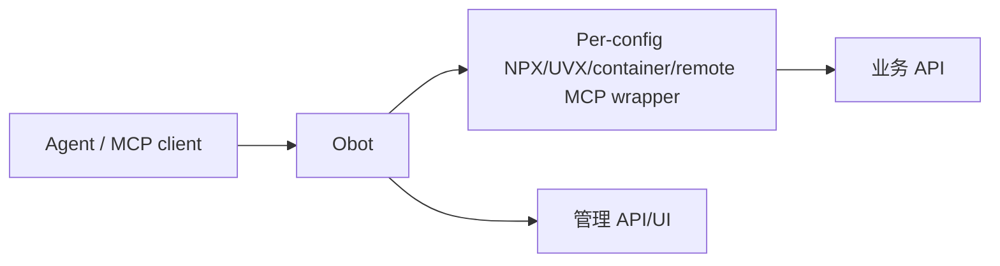
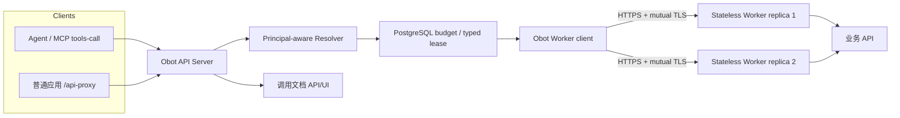

# OpenAPI Workers v1 验收审阅包

版本：`v1-acceptance-r3`。时间：2026-11-10 15:39 Asia/Shanghai。状态：**Ready for local/user acceptance**。代码尚未 commit/push；生产验收未开启。

首选视觉审阅入口：同目录 `ACCEPTANCE-REVIEW-v1.html`。该 HTML 汇总 11 个端到端审批步骤、13 张主线真实截图、架构前后对比、验证矩阵、剩余缺口和验收结论。
最新补充：HTML 已按用户要求的真实审批链路重排，覆盖原有能力回归、FastAPI `/docs`、Authorization 安全定义、管理员上传 OpenAPI、保存目录条目、发布开关 OFF/ON、最终用户 `tools/list`、授权 `tools/call`、HTTP API 文档、标准 `/api-proxy/.../openapi.json` 和真实 `/api-proxy` 调用，最后进入架构与扩缩容。公开机器契约只包含调用方可见的 OpenAPI 字段和 `X-API-Key`，不泄露内部凭证注入或执行元数据。注意：本地 auth disabled 且 Admin 市场页会显示未上架条目，因此不能声称已完成真实非 Admin 用户添加前后市场对照。

## 1. PR 摘要

本版本把 OpenAPI 执行从“每个配置各自启动/连接一个 MCP wrapper”的模式，改为“Obot 统一授权和预算，多个无状态 OpenAPI Worker 通过 mTLS 执行 OpenAPI operation”。同时保留 vMCP/MCP 既有能力，新增普通应用 HTTP 出口和只读调用文档。

### 变更类型

| 类型 | 内容 |
| --- | --- |
| 新增 | Python OpenAPI Worker、Obot 固定 Worker 后端、`/api-proxy/{vmcp_id}/{component_id}/{path...}`、调用文档 API/UI、跨副本 PostgreSQL 预算租约 |
| 强化 | 精确用户/实例凭证、mTLS、raw path/query/Header/body、全局并发、SSE 拒绝、请求/响应上限、审计脱敏 |
| 重构 | MCP `tools/call` 与普通 HTTP 共用 Describe/Execute/预算入口；Worker 无数据库、无 Docker socket、无必须持久化本地状态 |
| 不变 | 现有 vMCP/组件/Profile/实例、MCP 连接、目录、凭证存储、UI 主要入口均保留 |

## 2. 架构前后对比

### Before



问题：

- OpenAPI wrapper 与配置绑定，无法横向复用。
- 普通应用没有直接 HTTP 出口。
- 各副本没有统一执行预算和租约 fence。
- 管理 `vmcp_id` 可见性与调用资格未彻底分离。
- Go/Python schema、path、Header、digest 语义未统一。

### After



关键变化：

- Obot 是唯一 Principal-aware Resolver/Executor：每次 Describe/Execute 实时校验用户、实例、组件、operation、凭证和 API Key scope。
- Worker 只收固定四端点 JSON 协议；业务凭证仅逐请求通过 mTLS 传输，不落盘。
- 全局预算、队列、typed lease 和审计状态在 PostgreSQL；Worker 可任意重建/扩缩容。
- `Authorization` 作为业务凭证例外：调用方传平台 Key，Obot 注入当前用户实例的业务 Authorization。
- raw path、query、Header、body 和业务 status/Header/body 保留，平台错误单独使用 JSON 错误协议。

## 3. 用户故事与证据

| ID | 用户故事 | 结果 | 证据 / 截图 |
| --- | --- | --- | --- |
| US-01 | 作为应用，我要用平台身份直接调用已发布 OpenAPI operation，而不依赖 Agent/MCP 会话 | PASS（真实 I01 Python Worker + TLS fake upstream；授权/路径/凭证由集成代码验证） | `evidence/I05R-VERIFICATION.md` Code and protocol |
| US-02 | 作为同一平台两个用户，我要确保各自业务 token 不串用 | PASS：user-one 200、user-two 403，上游只看到对应 `Bearer user-*` | `TestRealI01PythonWorkerDescribeAndExecute` |
| US-03 | 作为应用开发者，我要查看只读 HTTP 调用文档、base path、参数和业务认证要求 | PASS：真实 vMCP、真实 API/UI、真实浏览器截图 | `evidence/REAL-VMCP-API-DOCS.png` |
| US-04 | 作为用户，我要确认本地栈可打开且现有导航完整 | PASS：真实 Compose UI 截图 | `evidence/LOCAL-COMPOSE-UI.png` |
| US-05 | 作为运维，我要横向扩缩容 Worker 且不丢业务状态 | PASS：隔离 K3s 2→3→2，全部 rollout 成功；Worker 无持久卷 | `evidence/I05R-VERIFICATION.md` Isolated Kubernetes acceptance |
| US-06 | 作为安全审核者，我要验证 Worker 只接受受信 Obot | PASS：有效 client cert 成功；无证书/错误证书拒绝 | `evidence/I05R-VERIFICATION.md` Worker mTLS |
| US-07 | 作为平台，我要跨 Obot/Worker 副本控制并发和 stale start | PASS：PostgreSQL 多 Manager 测试 + 928,529-state formal model | `pkg/openapi/executionbudget/postgres_test.go` |
| US-08 | 作为用户，我要继续使用既有 MCP/vMCP，不因新 HTTP 出口丢失功能 | PASS：MCP JSON bridge/stateless JSON 回归通过；现有导航保留 | `LOCAL-COMPOSE-UI.png`、Go tests |

### 截图

1. **真实 vMCP HTTP API 文档**：`docs/plans/openapi-workers/evidence/REAL-VMCP-API-DOCS.png`
   - 数据来自真实创建的 `Acceptance Items vMCP`、`Acceptance Items API` catalog entry、VMCP instance 和用户配置。
   - 展示 base path、GET operation、path/query 参数、schema、“需要业务认证”标记和复制按钮。
2. **本地 Compose 首页**：`docs/plans/openapi-workers/evidence/LOCAL-COMPOSE-UI.png`
   - 展示本地 `http://127.0.0.1:18080` 真实页面、完整主导航和欢迎弹窗。
3. **组件级文档弹窗回归截图**：`docs/plans/openapi-workers/evidence/I05R-UI-BROWSER.png`
   - 展示 base path、GET operation、path template、参数 schema、“需要业务认证”标记和复制按钮。

## 4. 本地验收环境

当前正在运行：

```text
Project: openapi-workers-local
URL:     http://127.0.0.1:18080
Topology: 1 Obot + 2 OpenAPI Worker + 1 PostgreSQL
Host binding: 127.0.0.1:18080
Seed:    Acceptance Items API → Acceptance Items vMCP → user instance/configuration
```

验证：

```bash
curl http://127.0.0.1:18080/api/healthz
curl http://127.0.0.1:18080/api/version
```

已确认：

- `/api/healthz` → `ok`
- `/api/version` → `engine=openapi-worker`
- `hostingCapabilities.openAPIWorker=true`
- `sessionStore=db`
- Worker mTLS 正例/无证书负例通过。
- 真实 vMCP 文档 API 返回 HTTP 200，包含 `GET /items/{id}`、path/query 参数和 `businessAuthRequired=true`。

停止：

```bash
cd /Users/echo/orca/workspaces/obot/openapi-k8s-acceptance/deploy/compose
OBOT_POSTGRES_PASSWORD="$(cat /tmp/openapi-compose-password)" \
  docker compose -p openapi-workers-local down
```

## 5. 主要验证结果

| 验证 | 结果 |
| --- | --- |
| 目标 Go packages tests/vet | PASS |
| Python Worker 23 tests | PASS |
| 真实 Python Worker describe/execute | PASS |
| 双用户 200/403 + 精确凭证 | PASS |
| UI browser test | PASS |
| Svelte check | 0 error / 0 warning |
| 四语言 key | PASS |
| 真实浏览器截图 | PASS |
| Docusaurus typecheck/build | PASS |
| I02 formal baseline/broken | PASS / expected failure |
| I04 formal 928,529 states | PASS / expected mutations |
| 隔离 K8s 2 Obot + 2 Worker | PASS |
| scale 2→3→2 | PASS |
| mTLS 正负例 | PASS |
| K8s runtime cleanup | PASS：无 `openapi-k3s-acceptance` 容器 |

## 6. 文件/功能审阅入口

| Area | 主要路径 |
| --- | --- |
| Python Worker | `workers/openapi/**` |
| Go Worker 协议/Resolver/Executor | `pkg/openapiworker/**` |
| HTTP proxy | `pkg/api/handlers/apiproxy/**` |
| Dedicated authz | `pkg/api/authz/apiproxy*.go` |
| Raw server branch | `pkg/api/server/server.go` |
| MCP JSON bridge | `pkg/api/handlers/mcpgateway/openapi_bridge*.go` |
| Budget/lease | `pkg/openapi/executionbudget/**` |
| DB migration/types | `pkg/gateway/{db,types}/openapi_*` |
| Service/router wiring | `pkg/services/config.go`, `pkg/api/router/router.go` |
| UI 文档弹窗 | `ui/user/src/lib/components/vmcps/VMcpAPIDocumentationDialog.svelte` |
| 文档页面 | `docs/docs/mcp-gateway/connect-clients.md` |
| Compose | `deploy/compose/docker-compose.yml` |
| K8s example | `deploy/k8s/openapi-workers.example.yaml` |

## 7. 剩余缺口与验收边界

| ID | 缺口 | 影响 | 建议验收状态 |
| --- | --- | --- | --- |
| GAP-01 | 未用真实企业 IdP/业务系统/JWT | 不能声明企业授权交换或生产业务安全 | 本地验收 PASS；生产验收 pending |
| GAP-02 | 未部署生产 ingress/cert-manager/镜像仓库 | 未验证生产 TLS、容量和发布流程 | 生产验收 pending |
| GAP-04 | K8s 验收在隔离 K3s，不在公司已有 Namespace | 未验证公司 RBAC/网络/存储策略 | 生产预发验收 pending |
| GAP-05 | Worker kill/断连的完整长链路矩阵由模型和单元/PostgreSQL 回归覆盖，未在 K8s 中逐一杀死 Pod 录制 | 崩溃恢复机制已验证，生产故障注入仍待做 | 生产预发验收 pending |
| GAP-06 | 所有实现未 commit/push | 无法产生 PR diff | 人工审阅当前 worktree；待确认后整理提交 |
| GAP-07 | 本地 auth disabled，Admin 市场页会显示未上架条目 | 不能证明真实非 Admin 用户添加前后市场可见性 | 启用真实 IdP 后补验 |

## 8. 验收结论

**本地/用户验收：可验收。**

理由：

- 核心 Go/Python/UI/docs/formal/K8s/Compose 验证均通过。
- 真实 Worker 进程、双用户凭证隔离、业务 403 保留、mTLS 正负例和 2→3→2 扩缩容均有证据。
- 现有 UI/MCP/vMCP 导航保留，新增入口明确。

**生产验收：NOT READY。**

生产验收必须补：真实企业授权、真实业务 API、生产/预发 Namespace、生产 TLS 和证书轮换、容量与故障注入。

## 9. 验收准备期发现并已修复的问题

| ID | 问题 | 修复 / 证据 |
| --- | --- | --- |
| PRE-01 | HTTP proxy adapter 把 `VMCPInstanceID` 误当作 Resolver connection ID，导致真实 vMCP 文档 503 | 修正为查找当前用户、当前 VMCP instance、当前 component 的 `MCPServerInstance`；新增 `TestWorkerReferenceUsesCurrentUserConnection` |
| PRE-02 | API 手工创建的 VMCP 缺少预算 source reference，导致 `budget_identity_unavailable` | 为手工 catalog 组件生成稳定内部 `sourceURL::entryKey`；目标 Go tests 通过 |
| PRE-03 | 文档 Header policy 丢失 `Required`，导致 UI 未显示“需要业务认证” | Adapter 映射 Required；真实 API 返回 `businessAuthRequired=true` |
| PRE-04 | 本地 Worker 镜像是 Authorization credential 例外修复前构建的旧镜像 | 重建 `obot-openapi-worker:local`；真实文档 API/UI 通过 |
| PRE-05 | OpenAPI MCP bridge initialize 未声明 tools capability，聚合层不执行 tools/list，外部看到空工具列表 | initialize capabilities 增加 `tools: {}`；真实 Inspector 显示 FastAPI operation 工具 |
| PRE-06 | 工具名优先使用含空格的 DisplayName，违反 MCP 标识符规则 | 优先暴露安全 operationId 并清理标识符；新增单元测试 |
| PRE-07 | Worker 默认 DNS 解析误用 `asyncio.SocketKind`，域名上游触发 internal error | 改为 `socket.SOCK_STREAM`；新增真实 hostname resolver 测试 |
| PRE-08 | 本地 Compose 中 vMCP 聚合回环和 FastAPI 私网地址被安全策略阻断 | 配置 Obot 内部服务地址与显式 allowlist，不放宽全部私网；K8s example 同步内部服务地址 |

## 10. 建议审阅顺序

1. 打开 `http://127.0.0.1:18080`，点「继续」进入首页。
2. 核对主导航仍包含仪表板、市场、vMCP、MCP 服务器、技能、审计日志等入口。
3. 查看截图 `LOCAL-COMPOSE-UI.png`。
4. 查看截图 `REAL-VMCP-API-DOCS.png`，确认 HTTP API 文档内容。
5. 阅读本文第 2、3、7、9 节。
6. 如需技术复核，阅读 `evidence/I05R-VERIFICATION.md`。
