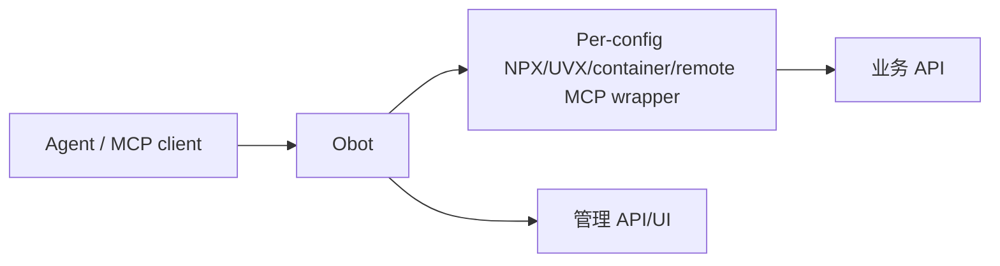
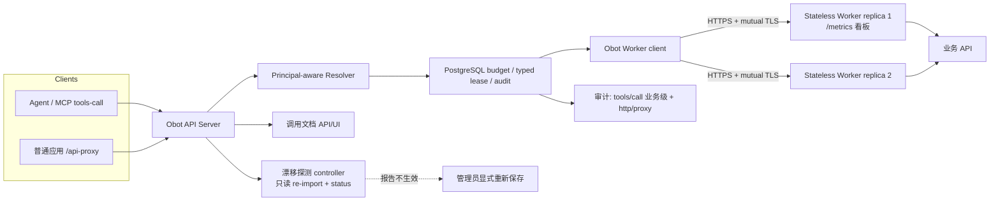

# OpenAPI Workers v2 验收审阅包

版本：`v2-acceptance-r1`。时间：2026-11-11 01:00 Asia/Shanghai。状态：**Ready for local/user acceptance**。代码未 commit/push；生产验收未开启。

v2 = v1 全部主线 + 三项用户后续增量：运维看板（Worker `/metrics`）、上游 schema 漂移自动探测（只探测不生效）、OpenAPI MCP 调用审计闭环。v1 的 11 步主线截图与结论继续有效，本包在其上扩展；历史版本 `ACCEPTANCE-REVIEW-v1.md`。

首选视觉审阅入口：同目录 `ACCEPTANCE-REVIEW-v2.html`（含 11 步 v1 主线 + v2 增量步骤与全部截图）。

## 1. PR 摘要

本版本把 OpenAPI 执行从"每个配置各自启动/连接一个 MCP wrapper"的模式，改为"Obot 统一授权/预算/审计，多个无状态 OpenAPI Worker 通过 mTLS 执行 OpenAPI operation"，并在 v1 之后补齐三项运营能力。

### 变更类型

| 类型 | 内容 |
| --- | --- |
| 新增 | Python OpenAPI Worker、Obot 固定 Worker 后端、`/api-proxy/{vmcp_id}/{component_id}/{path...}`、调用文档 API/UI、跨副本 PostgreSQL 预算租约 |
| 新增 (v2) | Worker `GET /metrics` 运维看板端点（Prometheus 文本格式，mTLS 监听内） |
| 新增 (v2) | 上游 OpenAPI schema 漂移自动探测（catalog entry status 只读报告，永不自动生效） |
| 新增 (v2) | OpenAPI MCP `tools/call` 业务级审计 + `/api-proxy` HTTP 出口审计（`http/proxy`） |
| 强化 | 精确用户/实例凭证、mTLS、raw path/query/Header/body、全局并发、SSE 拒绝、请求/响应上限 |
| 强化 (v2) | JSON-RPC 失败审计不再伪装成功（error 字段记录 `jsonrpc error <code>`） |
| 修复 (v2) | `/usage` 页面脱离全局布局（`h-dvh` 裁切）；Worker dev 模式 http baseURL 误拒；egress hosts 环境变量未读取 |
| 不变 | 现有 vMCP/组件/Profile/实例、MCP 连接、目录、凭证存储、UI 主要入口均保留 |

## 2. 架构前后对比

### Before



问题：wrapper 与配置绑定无法横向复用；普通应用无 HTTP 出口；无统一预算/租约；管理可见性与调用资格未分离；无运维指标；上游 schema 变化不可见；OpenAPI 调用无业务级审计。

### After



关键变化（含 v2 增量）：

- Obot 是唯一 Principal-aware Resolver/Executor：每次 Describe/Execute 实时校验用户、实例、组件、operation、凭证和 API Key scope。
- Worker 只收固定五端点 JSON/文本协议（describe/execute/healthz/readyz/metrics）；业务凭证仅逐请求通过 mTLS 传输，不落盘。
- 全局预算、队列、typed lease、审计状态在 PostgreSQL；Worker 可任意重建/扩缩容。
- `Authorization` 作为业务凭证例外：调用方传平台 Key，Obot 注入当前用户实例的业务 Authorization。
- v2：Worker 自带 Prometheus 指标；上游漂移 30 秒（可配）内自动报告且快照不动；MCP 与 HTTP 两条出口都落业务级审计。

## 3. 用户故事与证据

### v1 主线（全部继续有效）

| ID | 用户故事 | 结果 | 证据 / 截图 |
| --- | --- | --- | --- |
| US-01 | 作为应用，我要用平台身份直接调用已发布 OpenAPI operation，而不依赖 Agent/MCP 会话 | PASS（真实 I01 Python Worker + TLS fake upstream；授权/路径/凭证由集成代码验证） | `evidence/I05R-VERIFICATION.md` Code and protocol |
| US-02 | 作为同一平台两个用户，我要确保各自业务 token 不串用 | PASS：user-one 200、user-two 403，上游只看到对应 `Bearer user-*` | `TestRealI01PythonWorkerDescribeAndExecute` |
| US-03 | 作为应用开发者，我要查看只读 HTTP 调用文档、base path、参数和业务认证要求 | PASS：真实 vMCP、真实 API/UI、真实浏览器截图 | `evidence/REAL-VMCP-API-DOCS.png` |
| US-04 | 作为用户，我要确认本地栈可打开且现有导航完整 | PASS：真实 Compose UI 截图 | `evidence/LOCAL-COMPOSE-UI.png` |
| US-05 | 作为运维，我要横向扩缩容 Worker 且不丢业务状态 | PASS：隔离 K3s 2→3→2，全部 rollout 成功；Worker 无持久卷 | `evidence/I05R-VERIFICATION.md` Isolated Kubernetes acceptance |
| US-06 | 作为安全审核者，我要验证 Worker 只接受受信 Obot | PASS：有效 client cert 成功；无证书/错误证书拒绝 | `evidence/I05R-VERIFICATION.md` Worker mTLS |
| US-07 | 作为平台，我要跨 Obot/Worker 副本控制并发和 stale start | PASS：PostgreSQL 多 Manager 测试 + 928,529-state formal model | `pkg/openapi/executionbudget/postgres_test.go` |
| US-08 | 作为用户，我要继续使用既有 MCP/vMCP，不因新 HTTP 出口丢失功能 | PASS：MCP JSON bridge/stateless JSON 回归通过；现有导航保留 | `LOCAL-COMPOSE-UI.png`、Go tests |

### v2 增量

| ID | 用户故事 | 结果 | 证据 / 截图 |
| --- | --- | --- | --- |
| US-09 | 作为运维，我要把 Worker 接入运维看板，看到缓存/编译/请求/上游指标 | PASS：`GET /metrics` mTLS 200 + `text/plain; version=0.0.4`；注入 5× healthz/readyz 后计数器精确 5/5；无证书握手即拒；无 requestID/digest/URL 泄漏为标签 | `evidence/WORKER-METRICS.png`、`evidence/OPS-ACCEPTANCE.md` A1–A6 |
| US-10 | 作为管理员，上游 OpenAPI 变了（加/删接口、字段变化）我要能自动探测到，但绝不自动生效 | PASS：上游 v1↔v2 切换后一个探测周期内 `detected=true`，三类变化精确分类（`added=["POST /removed"]`、`removed=["GET /added"]`、`changed=["GET /items/{item_id}"]`）；探测后快照 digest 不变；显式重新保存后快照切换、再探 clean | `evidence/DRIFT-DETECTED-API.png`、`evidence/OPS-ACCEPTANCE.md` B1–B9 |
| US-11 | 作为审计员，OpenAPI MCP `tools/call` 的业务执行（operation、业务状态码、有界出入参）必须可审计 | PASS：真实 MCP 会话 `tools/call getItem` → 库中 bridge 层条目 `mcp_server_display_name=Drift Acceptance API`、业务 status=200、32KiB 有界脱敏 body | `evidence/AUDIT-E2E-ACCEPTANCE.md` F1 |
| US-12 | 作为审计员，`/api-proxy` HTTP 出口的每次业务调用必须可审计 | PASS：`GET /api-proxy/.../items/5` → 库中 `call_type=http/proxy`、`call_identifier=GET /items/{item_id}`、status=200、30ms、有界 body | `evidence/AUDIT-E2E-ACCEPTANCE.md` F3 |
| US-13 | 作为审计员，失败的调用不能在审计里伪装成功 | PASS：`tools/call nonexistent` → 审计 error 字段记录 `jsonrpc error -32602: unknown tool "nonexistent"`（修复前为 200+空 error） | `evidence/AUDIT-E2E-ACCEPTANCE.md` F2 |
| US-14 | 作为用户，`/usage` 用量页要在全局布局内正常展示，不裁切内容 | PASS：移除 `h-dvh` 后完整可滚（docScrollH 1482 > viewport 800），页面展示本次会话真实审计数据 | `evidence/USAGE-PAGE-FIXED.png` |

### 截图索引

**v1 主线（13 张，见 v1 包）**：`LIFECYCLE-01`–`LIFECYCLE-09`（FastAPI `/docs` → 管理员导入 → 发布开关 OFF/ON → 市场 → MCP `tools/list`/`tools/call` → HTTP API 文档 → `openapi.json` → 真实 `/api-proxy` 调用）、`REAL-VMCP-API-DOCS.png`、`LOCAL-COMPOSE-UI.png`、`I05R-UI-BROWSER.png`。

**v2 增量（4 张）**：

1. **Worker 运维看板**：`evidence/WORKER-METRICS.png` — 真实 mTLS 抓取的 `/metrics` 输出，计数器 5/5 精确对应注入流量。
2. **漂移探测命中**：`evidence/DRIFT-DETECTED-API.png` — 真实 Obot API 响应 `openAPISourceDrift.detected=true`，含三类 operation 清单与双侧 digest。
3. **用量页布局修复**：`evidence/USAGE-PAGE-FIXED.png` — 修复后的 `/usage`，展示本次会话产生的真实调用统计（工具计数、错误面板、服务器分布）。
4. **审计日志页**：`evidence/AUDIT-LOGS-PAGE.png` — 审计 UI 渲染上述条目。

## 4. 本地验收环境（v2 增量轮次）

```text
Project:   openapi-workers-local（deploy/compose，隔离验证后已清理）
Topology:  1 Obot (image 3b5422df) + 2 OpenAPI Worker (image bf5528dc) + 1 PostgreSQL
合成上游:  host.docker.internal:18081，手写 v1/v2 schema，/__set_version 切换
加速配置:  MCPOpenAPIDriftProbeInterval=30s（生产默认 6h）、OPENAPI_WORKER_ALLOW_LOCAL_TEST_EGRESS=1
验证链路:  Drift Acceptance API entry → Audit Acceptance vMCP (vmcp1f72ql) → MCP 会话 → 聚合 → bridge → mTLS Worker → 上游
```

复现验收的完整流程已固化为 Skill：`.codex/skills/obot-openapi-acceptance/SKILL.md`（含镜像重建坑、假上游规格、检查矩阵、截图流程、失败排查表）。

## 5. 主要验证结果

### v1 基线（全部继续有效）

| 验证 | 结果 |
| --- | --- |
| 目标 Go packages tests/vet | PASS |
| Python Worker tests（v2 轮 28/28，含 metrics/egress 增量） | PASS |
| 真实 Python Worker describe/execute + 双用户隔离 | PASS |
| UI browser test / Svelte check / 四语言 key | PASS |
| I02 formal baseline/broken；I04 formal 928,529 states | PASS / expected failure |
| 隔离 K8s 2 Obot + 2 Worker、scale 2→3→2、mTLS 正负例 | PASS |

### v2 增量

| 验证 | 结果 |
| --- | --- |
| `/metrics` 端点格式/计数精确性/mTLS 负例/无泄漏 | PASS（`OPS-ACCEPTANCE.md` A1–A6） |
| 漂移探测命中分类/不自动生效/显式采纳闭环 | PASS（`OPS-ACCEPTANCE.md` B1–B9） |
| 漂移探测 handler 单测（跳过条件/退避/失败/未配置） | PASS（6 用例） |
| 漂移 diff 单测（无变化/加删改/仅描述变化/缺输入） | PASS（4 用例） |
| bridge 审计 + http/proxy 审计单测（成功/失败/截断/nil collector） | PASS |
| 真实 MCP `tools/call` 三场景落库（成功/未知工具/HTTP 出口） | PASS（`AUDIT-E2E-ACCEPTANCE.md` 调用矩阵） |
| Worker metrics 与审计互证（execute ok=1 ↔ 库中 status=200） | PASS |
| `/usage` 布局修复 + spec test + `pnpm run check` 0/0 | PASS |
| 05 全量回归 + 02/03/01 各自写集镜像同步后全绿 | PASS |

## 6. 文件/功能审阅入口

| Area | 主要路径 |
| --- | --- |
| Python Worker | `workers/openapi/**`（v2：`metrics.py`、`app.py` egress env、`snapshot.py` http baseURL） |
| Worker 运维指标 | `workers/openapi/openapi_worker/metrics.py`、`tests/test_metrics.py` |
| 漂移探测 | `pkg/openapi/drift.go`、`pkg/controller/handlers/mcpservercatalogentry/openapidrift*.go`、`v1.MCPServerCatalogEntryStatus.OpenAPISourceDrift` |
| Go Worker 协议/Resolver/Executor | `pkg/openapiworker/**` |
| HTTP proxy + 出口审计 | `pkg/api/handlers/apiproxy/**`（v2：`audit.go`、`audit_test.go`） |
| MCP bridge + 业务审计 | `pkg/api/handlers/mcpgateway/openapi_bridge*.go`、`proxy_audit.go`（JSON-RPC error 修复） |
| 预算/租约 | `pkg/openapi/executionbudget/**` |
| UI 布局修复 | `ui/user/src/routes/usage/McpUsageView.svelte` |
| Compose / K8s | `deploy/compose/docker-compose.yml`、`deploy/k8s/openapi-workers.example.yaml` |
| 验收 Skill | `.codex/skills/obot-openapi-acceptance/SKILL.md` |

## 7. 剩余缺口与验收边界

| ID | 缺口 | 影响 | 建议验收状态 |
| --- | --- | --- | --- |
| GAP-01 | 未用真实企业 IdP/业务系统/JWT | 不能声明企业授权交换或生产业务安全 | 本地验收 PASS；生产验收 pending |
| GAP-02 | 未部署生产 ingress/cert-manager/镜像仓库 | 未验证生产 TLS、容量和发布流程 | 生产验收 pending |
| GAP-03 | **(v2)** 未部署真实 Prometheus/Grafana | `/metrics` 的抓取兼容性由 exposition 格式与 content-type 断言，未接真实看板 | 本地验收 PASS；部署接线 pending |
| GAP-04 | K8s 验收在隔离 K3s，不在公司已有 Namespace | 未验证公司 RBAC/网络/存储策略 | 生产预发验收 pending |
| GAP-05 | Worker kill/断连完整长链路矩阵未在 K8s 逐一录制 | 崩溃恢复机制已验证，生产故障注入仍待做 | 生产预发验收 pending |
| GAP-06 | 所有实现未 commit/push | 无法产生 PR diff | 人工审阅当前 worktree；待确认后整理提交 |
| GAP-07 | 本地 auth disabled，Admin 市场页会显示未上架条目 | 不能证明真实非 Admin 用户市场可见性 | 启用真实 IdP 后补验 |
| GAP-08 | **(v2)** 漂移生产默认 6h 间隔未等待实测；30s 加速覆盖 | 长周期调度行为由 RetryAfter 机制与单测保证 | 生产验收 pending |
| GAP-09 | **(v2)** I04 `CaptureBoundedAudit` 仍无调用方（新审计写入器内联实现了等价有界捕获） | 合并去重是后续工作 | 记录在案 |
| GAP-10 | **(v2)** vMCP `tools/call` 现产生两条审计（聚合协议层 + bridge 业务层），按设计共存 | UI 分组会同时显示 vMCP 与组件行（见 USAGE-PAGE-FIXED.png）；如需合并视图是 UI 后续工作 | 记录在案 |

## 8. 验收结论

**本地/用户验收：可验收。**

- v1 全部主线（真实 Worker、双用户隔离、mTLS、扩缩容、formal、K8s 隔离验收）继续有效。
- v2 三项增量全部有真实链路实证：`/metrics` 计数精确对应注入流量；漂移探测命中三类变化且快照不动、显式保存后收敛；MCP/HTTP 两条出口的业务级审计落库，失败调用不再伪装成功；`/usage` 布局修复。
- 验证过程中发现并修复 6 个真实缺陷（见第 9 节），其中 2 个是 v1 遗留的阻断性环境缺陷。

**生产验收：NOT READY。** 必须补：真实企业授权、真实业务 API、生产/预发 Namespace、生产 TLS 和证书轮换、容量与故障注入、真实 Prometheus/Grafana 接线。

## 9. 验收准备期发现并已修复的问题

### v1 轮（8 项，全部保持已修复状态）

| ID | 问题 | 修复 / 证据 |
| --- | --- | --- |
| PRE-01 | HTTP proxy adapter 把 `VMCPInstanceID` 误当 Resolver connection ID，真实 vMCP 文档 503 | 修正为查找当前用户/实例/组件的 `MCPServerInstance`；新增回归测试 |
| PRE-02 | 手工创建 VMCP 缺预算 source reference → `budget_identity_unavailable` | 生成稳定内部 `sourceURL::entryKey` |
| PRE-03 | 文档 Header policy 丢失 `Required` → UI 不显示"需要业务认证" | Adapter 映射 Required；API 返回 `businessAuthRequired=true` |
| PRE-04 | 本地 Worker 镜像旧于 Authorization 例外修复 | 重建镜像后通过 |
| PRE-05 | bridge initialize 未声明 tools capability → 外部空工具列表 | capabilities 增加 `tools: {}` |
| PRE-06 | 工具名优先含空格 DisplayName，违反 MCP 标识符规则 | 优先安全 operationId 并清理；新增单测 |
| PRE-07 | Worker DNS 解析误用 `asyncio.SocketKind` → internal error | 改 `socket.SOCK_STREAM`；新增 hostname resolver 测试 |
| PRE-08 | Compose 中 vMCP 聚合回环和私网地址被安全策略阻断 | 配置内部服务地址与显式 allowlist |

### v2 轮（6 项）

| ID | 问题 | 修复 / 证据 |
| --- | --- | --- |
| PRE-09 | **OpenAPI `tools/call` 业务执行零审计**：组件层被 `AuditLogIgnore` 有意跳过、bridge 什么都不写，业务状态码/operation 对审计不可见 | 新增 bridge 业务审计（剥离 ignore 标志、组件身份、32KiB 有界脱敏出入参）；库中实证 `Drift Acceptance API` status=200 |
| PRE-10 | **JSON-RPC 失败伪装成功**：`unknown tool` 记 200 + 空 error | 解析 JSON-RPC error 记入审计 error 字段；库中实证 `jsonrpc error -32602` |
| PRE-11 | **`/api-proxy` 出口零审计**（I04 有界采集器无调用方） | 新增 `http/proxy` 审计 + 4 单测；库中实证 operationKey/status/30ms |
| PRE-12 | `/usage` 页 `h-dvh` 嵌在 `h-svh` 滚动容器内裁切内容 | 移除 `h-dvh`；实测完整可滚，截图有真实数据 |
| PRE-13 | Worker `_validate_manifest` 无条件拒 http baseURL，与 Obot dev 模式不一致 → vMCP launch `snapshot_invalid` | 仅在 `OPENAPI_WORKER_ALLOW_LOCAL_TEST_EGRESS=1` 时放开 http；launch 200 |
| PRE-14 | compose 传 `OPENAPI_WORKER_ALLOWED_EGRESS_HOSTS` 但 Worker 不读（hosts 硬编码）→ `transport_uncertain` | Worker 解析该环境变量；metrics 实证 `execute ok=1` |
| PRE-15 | compose 预构建镜像 tag 不随 `up --build` 重建 → 新代码不进容器（症状：新端点 404/旧行为） | 验收 Skill 固化双镜像显式重建步骤 + 二进制符号核对 |

## 10. 建议审阅顺序

1. 打开 `ACCEPTANCE-REVIEW-v2.html` 视觉入口，过 11 步 v1 主线（FastAPI → 导入 → 发布 → MCP → HTTP）。
2. v2 增量四步：`WORKER-METRICS.png`（看板）→ `DRIFT-DETECTED-API.png`（探测命中）→ `AUDIT-E2E-ACCEPTANCE.md` 调用矩阵（审计落库）→ `USAGE-PAGE-FIXED.png`（布局与数据互证）。
3. 阅读本文第 3（v2 用户故事）、7（缺口）、9（v2 修复）节。
4. 技术复核：`evidence/I05R-VERIFICATION.md`（v1）+ `evidence/OPS-ACCEPTANCE.md` + `evidence/AUDIT-E2E-ACCEPTANCE.md`（v2）。
5. 复跑验收：按 `.codex/skills/obot-openapi-acceptance/SKILL.md` 执行。
