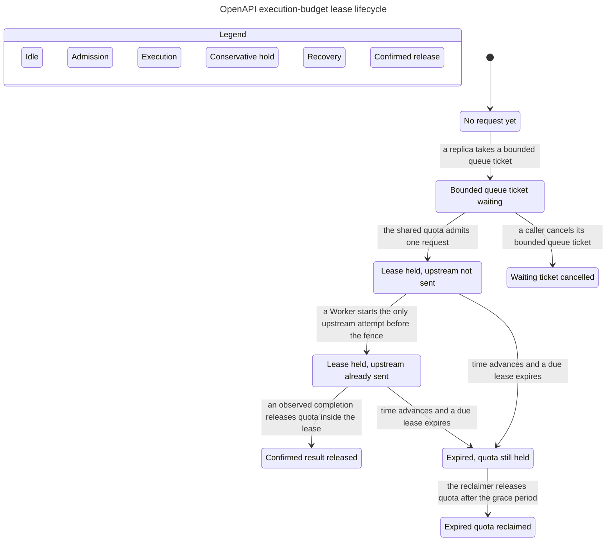

# F04 execution-budget lease formal verification evidence

## Result

- Property: a cross-replica active lease is unexpired, uniquely bound to one request, counted against the shared quota, and permits only a pre-fence upstream attempt; uncertain expiry remains reserved until reclaim grace. Violating this can over-admit business calls or let a crashed/stale Worker invoke upstream after its permit expires.
- Started / finished (UTC): `2026-11-10T02:00:58Z` / `2026-11-10T02:01:15Z`.
- Tool: TLA+ Tools v1.8.0, TLC build `2026.11.06.222357 (rev: d8fb231)`, jar SHA-256 `e1f11b75c4b5bc4478ba0ac5cb6ae28e40a01b0016bc33e0aa97da22dfdbcd7f`; Java output: `openjdk version "11.0.31" 2026-04-21 LTS`.
- Full restored model: `ExecutionBudgetLeases.cfg` — 1218530 generated / 928529 distinct states, 0 left; `TypeOK`, `ActiveLeaseSafety`, `ConfirmedReleaseInsideLease`, and `SnapshotRecoverySafety` all hold.
- Full early-release mutation: only `ConfirmedReleaseInsideLease` is violated. At `now=3`, `r1` changes from `expiredPending` to `completed` with `finishedAt=3` and `deadline=3`, releasing `reservedCount` before grace.
- Full stale-start mutation: only `ActiveLeaseSafety` is violated. At `now=2`, `r1` starts upstream for `deadline=3`; with fencing margin 1, `upstreamStart + FencingMargin < deadline` is false.
- Normal chart: 257 states; `TypeOK`, `LeaseSafety`, `ConfirmedReleaseInsideLease`, `SnapshotRecoverySafety`, and `NoDeadlock` hold; no rule is unchecked.
- Early chart: 315 states; exactly `ConfirmedReleaseInsideLease` breaks, `TypeOK`, `LeaseSafety`, `SnapshotRecoverySafety`, and `NoDeadlock` hold, and no rule is unchecked.
- Stale chart: 299 states; exactly `LeaseSafety` breaks, `TypeOK`, `ConfirmedReleaseInsideLease`, `SnapshotRecoverySafety`, and `NoDeadlock` hold, and no rule is unchecked.
- Full model SHA-256: `e5fe1fb70daff47ebafb7e5189d10c0a0429722a0c68f4d6a4c030523aaa6a84`.

## Commands

The repeat command is:

```bash
rtk bash .codex/skills/verify-openapi-execution-budgets/scripts/verify.sh
```

The script downloads TLA+ Tools only when `TLA2TOOLS` is absent, verifies the pinned SHA-256, runs the full model and both full mutations with Java TLC, and runs the normal plus two broken chart models with `/statechart`. It individually asserts all three non-empty `chart.mmd` files, parses exact invariant names, concrete lease values, absence of unexpected or unchecked rules, and rewrites this evidence file.

Raw full-model outputs are in `docs/plans/openapi-workers/formal/runs/latest/`. Chart artifacts are `statechart-chart/chart.mmd`, `statechart-broken-early/chart.mmd`, and `statechart-broken-stale/chart.mmd`, each beside `report.md` and `tlc.out`.

## Normal Mermaid chart



The chart hides repeated `Tick` and `Done` self-steps and interleavings that leave the same visible phase. Those remain in the TLC state graph. The two shortest broken-path charts are `statechart-broken-early/chart.mmd` and `statechart-broken-stale/chart.mmd`.

## Mapping and boundaries

- Full `phase` maps to `openapi_execution_requests.state`; `deadline` maps to the UTC lease deadline; `reservedCount` maps to active/unreclaimed shared quota; `origin` maps to `obot_instance_id`; `delivery` models Obot→Worker dispatch; `upstreamStart` models the only permitted business attempt.
- `Tick` atomically observes due waiting/active deadlines. `CancelWaitingAction` immediately cancels an unexpired waiting ticket without changing active quota. `SnapshotRequiredAction` keeps the active lease while awaiting the same-instance immutable snapshot, and `WorkerStartsUpstream` is blocked until `SnapshotRecoveredAction`. `ReclaimExpiredAction` releases quota only after `deadline + ReclaimGrace`; `ObotCrash` removes an undelivered dispatch so it cannot later start upstream; `WorkerStartsUpstream` requires the full fencing margin.
- The scalar chart models are projections for readable Mermaid output because the full function-heavy module is beyond the current statechart XML importer. They do not relax or replace the full baseline invariants.
- Not covered: PostgreSQL transactions/locks, release-token hash comparison, queue fairness among operations, HTTP cancellation propagation, retry/network behavior, payload limits, audit, clock drift beyond the modeled margin, and real deployment. A pass is not implementation, E2E, or deployment evidence.
